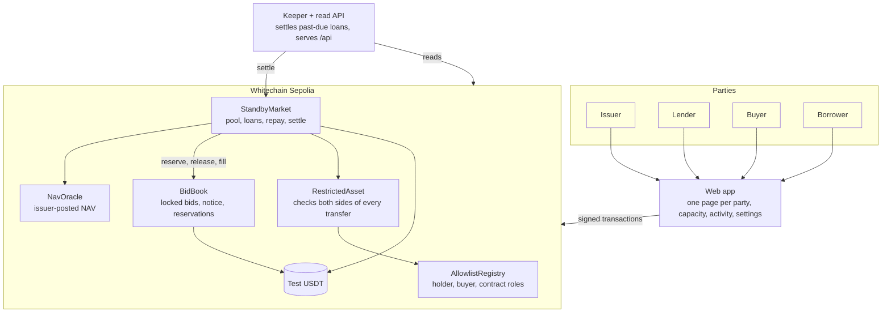
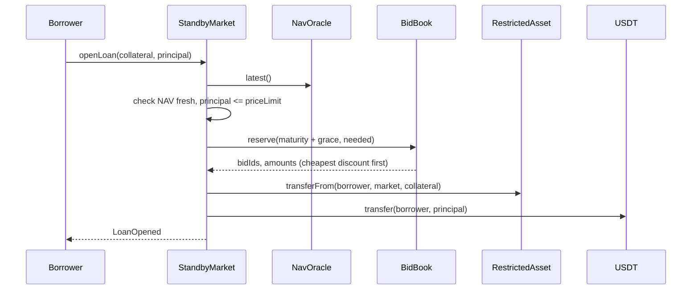
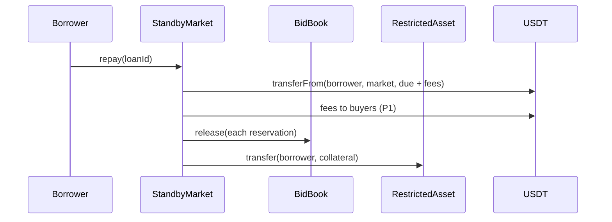
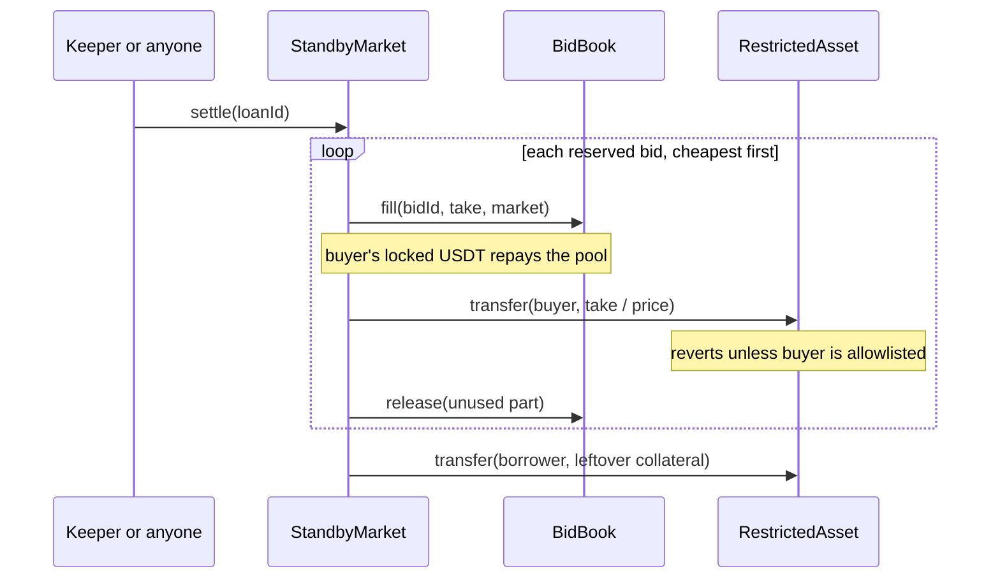
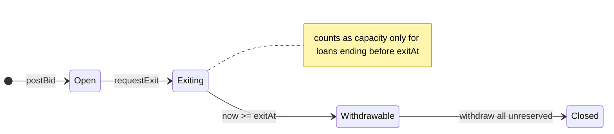
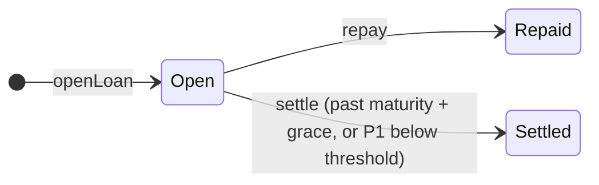

# Standby architecture

How the parts fit, how money moves, and which rules each contract enforces. Diagrams are Mermaid and render on GitHub and in the docs site. Exact signatures live in `docs/interfaces.md`.

## 1. Components

## 2. Opening a loan

## 3. Repayment (one transaction)

## 4. Default settlement (one transaction, delivery versus payment)

## 5. State machines

## 6. The limit

`maxBorrow = min(maxLtv × NAV × collateral, (1 − haircut) × freeCapacity(maturity + grace))`, solved for principal including interest to the end of grace. Each reserved dollar belongs to one loan. A bid in exit counts only for loans that end before it unlocks.

## 7. Trust and authority

| Actor | Can | Cannot |
|---|---|---|
| Issuer | Set roles, mint to holders, pause, post NAV | Move anyone's tokens or USDT, change market parameters |
| Market | Reserve, release and fill bids; hold collateral | Withdraw a buyer's unreserved USDT; send shares off the allowlist |
| Buyer | Post, exit after notice, withdraw unreserved USDT | Change a bid's discount; withdraw reserved USDT |
| Keeper | Call `settle` | Anything else (anyone can call `settle`) |
| Deployer | Set the bid book's market once | Anything after that |

Shares owed to an account that is off the allowlist at repayment or settlement are held by the market as a claim (`claimShares`), so the issuer's allowlist changes can never block a loan from closing.

Known limits: an issuer pause blocks repayment and settlement until unpaused; NAV is trusted from the issuer and settlement waits for a fresh one; a lender can exit before a pending shortfall is realised; no audit.

## 8. Off-chain parts

- **Keeper** (`keeper/`): polls open loans every 15 s, settles any `isSettleable`, retries at most three times. Also serves the read API (`docs/interfaces.md` section 6).
- **Web app** (`web/`): Vite + React + viem; design tokens shared with the docs site; party switcher with demo testnet wallets; every action ends with an explorer link.
- **Docs site** (`site/`): Docusaurus with Mermaid, same tokens.

## 9. Deployment

Foundry script deploys the five contracts, wires roles, verifies on Blockscout, writes addresses to `packages/shared/src/deployments.json`, and seeds the demo (shares, NAV, bids, pool deposit). Web app and docs site deploy as static sites.
